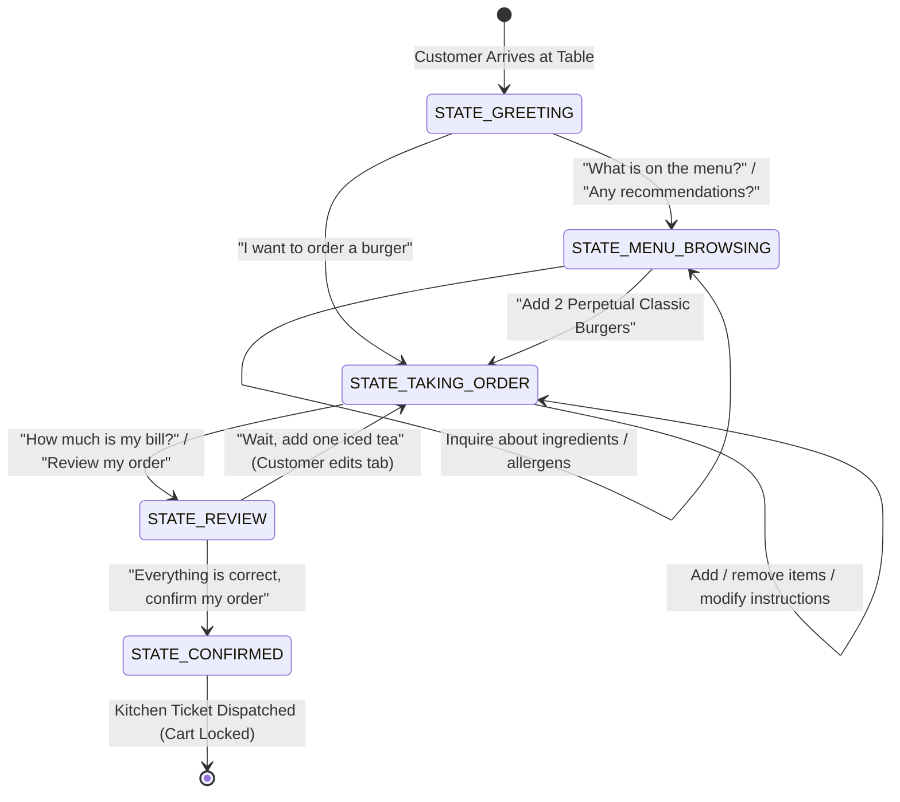

# Project Documentation: AI Virtual Waiter for Perpetual Bistro
## Multi-Modal Conversational Agent with Local LLM Tool Calling and Finite State Machine Control
**Course:** BSCS 3112 — Artificial Intelligence (Lab)  
**Institution:** University of Perpetual Help System DALTA — Las Piñas Campus  
**Instructor:** Prof. Rob Malitao  
**Authors / Team Members:**
- **Christian Ezekiel L. Carvajal** — BSCS - DS 3rd Year (Student ID: Lead Systems Architect & Driver)
- **John Miko P. Sarsalijo** — BSCS - DS 3rd Year (Student ID: Fullstack Lead & Driver)
**Execution Window:** October 19 – November 6, 2026  
**Final Project Due Date:** November 6, 2026 | **Live Defense:** November 7, 2026

---

## Video Walkthrough Demonstration
- **Demonstration Link:** `https://youtu.be/[YOUR_3_MINUTE_VIDEO_WALKTHROUGH_LINK]` *(3–5 Minute End-to-End Voice & Kiosk Demonstration)*
- **Demonstration Coverage:** Full voice transaction flow from table greeting, voice ordering, dietary allergen checking, manual cart override (+, -, Delete), KDS kitchen dispatch, and out-of-stock edge case handling.

---

## 1. Executive Summary & Business Scenario

Perpetual Bistro, the primary on-campus dining facility at the University of Perpetual Help System DALTA (UPHSD), requires an autonomous, table-side digital ordering kiosk to streamline dining operations during peak campus meal hours. 

To guarantee absolute institutional privacy, zero cloud subscription overhead, and operational resilience against campus network outages, the system runs **100% locally on edge laptop hardware**. It synthesizes:
1. **Local Speech Processing (STT / TTS)**: Voice input capture and Taglish neural voice synthesis.
2. **Conversational State Machine (FSM)**: Strict, deterministic dialogue lifecycle enforcing business rules.
3. **Agentic Tool Calling**: Dynamic binding between local Ollama (`qwen2.5`) reasoning and SQLite relational tools.
4. **Relational Data Integrity**: Real-time ACID transactions managing menu inventory, active cart tabs, and Kitchen Display System (KDS) routing.

```
+-----------------------------------------------------------------------------------------+
|                                1. I/O SURFACE LAYER                                     |
|  [ Microphone STT ]  <--->  [ Web Kiosk & KDS UI ]  <--->  [ Speaker Neural TTS ]      |
+-----------------------------------------------------------------------------------------+
                                           │
                                           ▼
+-----------------------------------------------------------------------------------------+
|                             2. CORE AGENT ENGINE LAYER                                  |
|   +------------------------------------+      +-------------------------------------+   |
|   |       FSM State Controller         | <--> |        Local Ollama / Qwen 2.5      |   |
|   | (GREETING/ORDERING/REVIEW/CONFIRM) |      |      (Reasoning & Intent Parser)    |   |
|   +------------------------------------+      +-------------------------------------+   |
+-----------------------------------------------------------------------------------------+
                                           │
                                           ▼
+-----------------------------------------------------------------------------------------+
|                        3. RELATIONAL PERSISTENCE LAYER (SQLite)                         |
|   [ menu_items (21 items) ]   [ table_sessions ]   [ order_line_items ]  [ kds_tickets ] |
+-----------------------------------------------------------------------------------------+
```

---

## 2. Layer-by-Layer System Architecture

### Layer 1: The I/O Surface Layer (`speech_engine.py` & `ui_dashboard/`)
This external boundary interacts directly with diner hardware at the dining table:
- **Speech-to-Text (STT)**: Microphone capture wrapper via `SpeechRecognition` or browser Web Speech API with silence threshold detection (auto-sends query after 1.8s of silence).
- **Text-to-Speech (TTS)**: Phonetic normalization engine transforming currency symbols (`₱150` -> `150 pesos`) and school acronyms (`UPHSD` -> `Perpetual Help System DALTA`) into natural Philippine English/Taglish audio.
- **Web Tablet Dashboard**: Built with responsive HTML5/CSS3 featuring the official University Maroon (`#7B1113`) & Gold (`#D4AF37`) palette, multi-view catalog, dish customization modal, live cart table, manual override controls (+, -, Delete), and Back-of-House Kitchen Display System (KDS).

### Layer 2: Core Virtual Waiter Agent Engine (`fsm_controller.py`)
This middle processing layer bridges natural language reasoning with programmatic guardrails:
- **Finite State Machine (FSM)**: Enforces the 5 discrete operational states:
  - `STATE_GREETING`: Welcome customer and bind table number (Default: Table 1).
  - `STATE_MENU_BROWSING`: Provide menu listings, recommendations, and allergen facts.
  - `STATE_TAKING_ORDER`: Parse dish entities, quantities, and customizations (`No Onions`, `Extra Cheese`).
  - `STATE_REVIEW`: Present itemized tab with subtotal and tax breakdown for verification.
  - `STATE_CONFIRMED`: Lock cart, generate receipt, update inventory, and route kitchen ticket.
- **Local Ollama / Qwen 2.5**: Formulates structured tool calls from unconstrained conversational input without cloud latency. Dynamic fallback logic prioritizes lightweight models (`qwen2.5:1.5b`) to eliminate VRAM OOM errors on 4GB/6GB student laptops, paired with a deterministic regex parser for offline edge robustness.

### Layer 3: Relational Persistence Layer (`db_tools.py` & `restaurant.db`)
Single source of truth implemented in SQLite:
- `menu_items`: 21 authentic canteen offerings across 6 categories (Burgers, Pastas, Sides, Beverages, Desserts, Combos) including stock quantities (`stock_qty`) and allergen flags.
- `table_sessions`: Tracks table identification, creation timestamps, and active FSM state.
- `order_line_items` (and `cart_items` view): Tracks active tab line items, quantities, unit prices, and custom instructions.
- `kitchen_tickets`: Manages kitchen fulfillment queue (`PREPARING` -> `READY` -> `SERVED`) and payment records (Cash, GCash, Maya, RFID).

---

## 3. Finite State Machine State Transition Diagram



---

## 4. Programmatic Guardrails & Edge-Case Handling

The architecture includes defensive guardrails designed specifically to withstand the instructor's panel stress tests:

| Stress Test / Edge Case | Failure Mode in Unchecked Agents | Programmatic Guardrail Implemented in Perpetual Bistro | Verification Outcome |
| :--- | :--- | :--- | :--- |
| **Out-of-Stock Item** (e.g. Crispy Buffalo Chicken Tenders, stock = 0) | Agent promises unavailable food; inventory goes negative or crashes at kitchen checkout. | `db_tools.add_item_to_order()` queries `stock_qty` before executing insert. If `stock_qty == 0`, transaction is rejected; system queries available dishes in same category and instructs agent to offer them. | **Blocked**: Order refused, alternatives suggested. |
| **Quantity Exceeds Stock** (Customer requests 5, but stock = 2) | Silent truncation or partial commits leaving cart inconsistent. | Code compares requested quantity against `stock_qty`. Rejects mutation with explicit notification: *"Only 2 left in stock"*. | **Blocked**: User notified of remaining stock. |
| **Post-Confirmation Mutation Attempt** | Diner tries to modify or cancel dishes after the kitchen has started preparation. | FSM Controller checks `table_sessions.status`. Once in `STATE_CONFIRMED`, all mutation tools (`add`, `update`, `remove`) are hard-locked, returning: *"Order #X is already confirmed and sent to kitchen"*. | **Blocked**: Modifications rejected with explanation. |
| **Illegal State Shortcuts** (Jumping from `GREETING` to `CONFIRMED`) | Customer says "Bill please" before adding anything to their cart. | Transition guards verify `cart_items.count > 0` before allowing transition into `STATE_REVIEW` or `STATE_CONFIRMED`. Empty checkout attempts return friendly prompt to order first. | **Blocked**: Premature checkout prevented. |
| **Out-of-Domain Query Injection** ("What is the weather today?", "Write a poem") | Agent hallucinates, deviates into irrelevant topics, and forgets conversation state. | System prompt boundary conditions and regex intent guards politely reject off-topic questions and re-anchor diner to Perpetual Bistro menu selections. | **Protected**: Polite redirect back to food service. |

---

## 5. Tandem Pair Programming Collaboration Log

In accordance with the Extreme Programming (XP) Pair Programming standard required by UPHSD AI Department:

### Milestone 1 (Oct 19 – Oct 28, 2026) — 40% Weight
* **Driver:** Christian Ezekiel L. Carvajal
* **Navigator:** John Miko P. Sarsalijo
* **Focus Modules:** SQLite schema (`init_restaurant_db.sql`), DB CRUD engine (`db_tools.py`), FSM state controller (`fsm_controller.py`), and decoupled speech engine (`speech_engine.py`).
* **Tactical Output:**
  - Designed relational database schema with foreign keys, cascading constraints, and 21 authentic UPHSD menu items.
  - Implemented atomic stock reservation transactions with automated rollback on concurrency conflicts.
  - Built `fsm_controller.py` enforcing strict transitions across all 5 dialogue states.
  - Engineered `speech_engine.py` with STT audio capture and phonetic Taglish TTS normalization.
* **Navigator Feedback (Sarsalijo):**
  - Added multi-model fallback to support 8GB student laptops running `qwen2.5:1.5b`.
  - Audited SQLite edge cases, verifying zero errors when querying out-of-stock items.

### Milestone 2 (Oct 29 – Nov 06, 2026) — 60% Weight
* **Driver:** John Miko P. Sarsalijo
* **Navigator:** Christian Ezekiel L. Carvajal
* **Focus Modules:** Web UI Dashboard (`ui_dashboard/`), Dish Customization Modal, Live KDS Queue, Payment Integration, and `app.py`.
* **Tactical Output:**
  - Built commercial tablet ordering dashboard themed in Perpetual Maroon (`#7B1113`) & Imperial Gold (`#D4AF37`).
  - Created Kitchen Display System (KDS) board with live ticket lifecycles (`PREPARING` -> `READY` -> `SERVED`).
  - Added dish customization modal for ingredient modifications (`No Onions`, `Extra Cheese`, `Make it Spicy`).
  - Assembled `app.py` chaining UI, Speech Engine, FSM, and SQLite tools.
* **Navigator Feedback (Carvajal):**
  - Optimized chef spotlight container from 360px column to responsive 1.35fr layout (`aspect-ratio: 1535/1024`) ensuring all 7 chefs fit edge-to-edge without cropping.
  - Audited API endpoints, confirming zero syntax errors across all modules.

### Work Distribution Summary

| Team Member | Primary Roles Held | Key Modules Authored | Contribution Share |
| :--- | :--- | :--- | :---: |
| **Christian Ezekiel L. Carvajal** | Systems Architect / Lead Driver (M1)<br>Navigator (M2) | `init_restaurant_db.sql`, `init_db.py`, `db_tools.py`, `speech_engine.py`, layout bounds | 50% |
| **John Miko P. Sarsalijo** | Fullstack Lead / Lead Driver (M2)<br>Navigator (M1) | `fsm_controller.py`, `app.py`, `ui_dashboard/` (templates & static), KDS workflow | 50% |

---

## 6. Live Defense Quick-Start & Operator Manual

### Prerequisites
1. Local Ollama installed and active: `ollama run qwen2.5:1.5b`
2. Python 3.10+ with dependencies installed:
   ```bash
   pip install fastapi uvicorn edge-tts requests pydantic jinja2
   ```

### Execution Steps
1. **Initialize Database**:
   ```bash
   python init_db.py --reset
   ```
2. **Launch Application**:
   ```bash
   python app.py --port 8000
   ```
3. **Access Tabletop Kiosk**:
   Open browser at [http://localhost:8000](http://localhost:8000) or on local tablet.

4. **Live Defense Test Verification**:
   - *Test 1 (Out-of-Stock)*: In chat or voice, say: *"I would like to order the Crispy Buffalo Chicken Tenders"*. Verify agent informs that stock is 0 and suggests available alternatives.
   - *Test 2 (Post-Confirmation Lock)*: Add a Perpetual Classic Burger, click Checkout or confirm via voice, then try saying: *"Cancel my order"* or *"Remove the burger"*. Verify system refuses modification because the order has already been finalized and routed to the kitchen.
